# VocalGzzio 歴代UI変遷録・旧版アーカイブ実機図鑑（v1.0.0 〜 v4.4.0）

旧版保管アーカイブ（`VocalGzzio_旧版保管用_v1.0.0-v4.3.3.zip`）に収録されている全37本のWindowsインストーラー（`v1.0.0`〜`v4.3.3`）およびMac旧版パッケージを展開・実機起動し、各バージョンの**初期ウィンドウ寸法（ViewRect）・画面レイアウト・操作体系・テーマ演出の変遷**をまとめました。

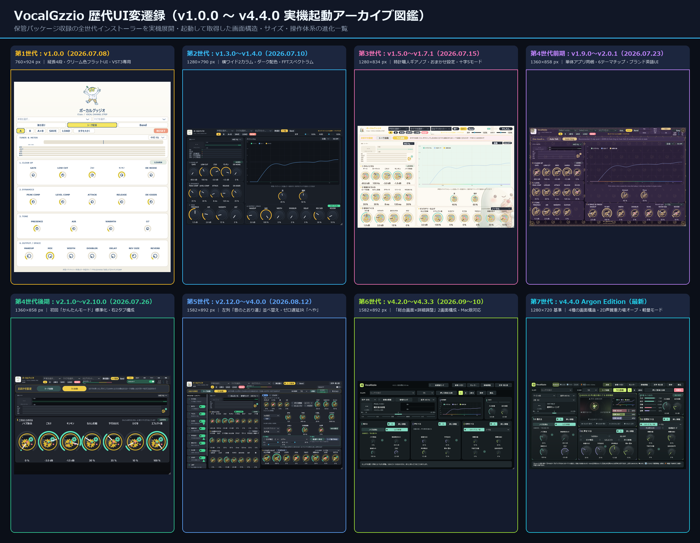

---

## 1. 全7世代のUI進化サマリー表

| 世代 | 対象バージョン | 公開時期 | 初期画面サイズ (100%時) | 同梱形式 | 画面構造・レイアウトの特徴 | ノブ・テーマ・主な新機能 |
| :--- | :--- | :--- | :--- | :--- | :--- | :--- |
| **第1世代** | `v1.0.0` | 2026年7月8日 | **760 × 924 px**（縦長） | Win VST3 | クリーム色背景・縦長1列4段カード（`1. CLEAN UP` / `2. DYNAMICS` / `3. TONE` / `4. OUTPUT / SPACE`）＋上部チューナー＆メーター | フラット円形ノブ、声質×マイク×3シーン（弾き語り／トーク配信／Band）、「文字を大きく」ボタン |
| **第2世代** | `v1.3.0` 〜 `v1.4.0` | 2026年7月10日〜13日 | **1280 × 790 px**（横ワイド） | Win VST3 | ダークUI化・横ワイド2カラム構成（左列：メーター＋1〜3段、右列：大型リアルタイムFFTスペクトラム＆ダイナミックEQ＋4段） | 文字・大きさ無段階スライダー（70%〜140%）、EQプリセット、`v1.4.0`で「スタンダード／かんたん」切替・AUTO SETUP追加 |
| **第3世代** | `v1.5.0` 〜 `v1.7.1` | 2026年7月15日〜21日 | **1280 × 834 px** | Win VST3 | ヘッダー直下に「おまかせ設定（トーク自動／うた自動）」バーを新設。セクション見出しを日本語化（`1 きれいにする`〜`4 ひろがり・仕上げ`） | 黄金の歯車が噛み合う「時計職人（Watchmaker）ギアノブ」導入、`v1.7.0`で右上「十字5モードスイッチ」＆ゆるふわモード（ぷにぐじ・ジュースサーバー・Mochiy Pop One）搭載 |
| **第4世代（前期）** | `v1.9.0` 〜 `v2.0.1` | 2026年7月23日〜26日 | **1360 × 858 px** | Win VST3 + **単体起動 `.exe`** | 単体起動アプリ（`VocalGzzio.exe`）同梱開始。ヘッダー右上に星座型6テーマチップ（ゆるふわ／自然／ブランド／オーロラ／色覚／軽量＋中央N） | 四季アニメ背景（自然）、モノグラム＆全英語UI（ブランド）、`v2.0.0`で「艶」「サビリフト」ノブ追加 |
| **第4世代（後期）** | `v2.1.0` 〜 `v2.10.0` | 2026年7月26日〜8月6日 | **1360 × 858 px** | Win VST3 + 単体起動 `.exe` | 初回起動時の既定画面を、主要7〜8個の大型ギアノブが横一列に並ぶ「**かんたんモード**（`こえをととのえる`）」に統一。トグルOFFで全ノブ＋右2タブ（`EQ` / `エフェクト`）のこだわりモードへ展開 | ボイス変換（ピッチ・フォルマント）・5人ユニゾン・テンポ同期ディレイ・キャラ声・ピッチ補正＆最適キー検出、`v2.10.0`で音の種類・点検・追加遅延バッジ追加 |
| **第5世代** | `v2.12.0` 〜 `v4.0.0` | 2026年8月12日〜8月30日 | **1582 × 892 px** | Win VST3 + 単体起動 `.exe` | こだわりモード左端に信号経路列「**音のとおり道（上から下へ）**」を新設。各モジュールの個別ON/OFF・処理順の並べ替え（▲▼）・「くらべる」比較に対応。テーマ選択は「文字・見た目」ポップアップへ統合 | `v3.1.0`で使いかた4種（うた／アコギだけ／しゃべり／声とギター）＆「1つずつ」表示、`v4.0.0`で部屋の寸法から鏡像法計算するゼロ遅延IR畳み込みリバーブ「**へや**」6種を搭載 |
| **第6世代** | `v4.2.0` 〜 `v4.3.3` | 2026年9月〜10月 | **1582 × 892 px** | Win VST3 + `.exe` / **Mac VST3 + AU + `.app`** | 「**総合画面**（上段3モニター：`歌声・音程` / `音の輪郭` / `入出力` ＋ 下段3カード：`整える` / `声をつくる` / `空間をつくる`）」と「**詳細調整**」の2画面アーキテクチャへ全面刷新 | グリーン波形ピルロゴ、モダンフラットリングノブ、6種の仕上がり、標準6弦ギター／4・5弦ベース対応チューナー、Macユニバーサル版追加 |
| **第7世代（最新）** | **`v4.4.0`** (Gemini4Argon) | 2026年10月15日 | **1280 × 720 px** 論理基準（リサイズ対応） | Win VST3 + `.exe` / Mac VST3 + AU + `.app` + `.pkg` | ヘッダーの `[★ARGON / ♥LIVER / 🎛STUDIO / ◎従来]` ピルで**画面の骨格そのものが4通りに変形**するマルチ・ワークスペース構造＋中央「**Argon 2D 声の重力場オーブ**」 | 独自DSP「**Argon Velvet Engine**（母音追従2次倍音VELVET／クレスト保護14kHz SILK AIR／モノラル完全互換3D HALO）」、4種Voice DNA、ワンクリック省負荷「**⚡軽量モード**」 |

---

## 2. 世代別UIの詳細解説と実機スクリーンショット

### 第1世代：`v1.0.0`（2026年7月8日公開）— 縦長1列・クリーム色フラットUI
- **初期ウィンドウ寸法**：`760 × 924 px`（縦長ポートレート固定）
- **同梱バイナリ**：Windows VST3（`VocalGzzio.vst3`、単体起動アプリはまだ未同梱）
- **UIの特徴**：
  - 温かみのあるクリーム色（`#FAF8F3`）の背景に、上部中央へマスコットイラストと「ボーカルグッジオ / G'zzio / VOCAL CHANNEL STRIP」のタイトルを配置。
  - 「声質を選択...」「マイクを選択...」の2つのドロップダウンと、「弾き語り / トーク配信 / Band」の3つの大きなシーン切替ボタンで一発設定できる設計。
  - ツールバーには `A` / `B` / `A>B` / `SAVE` / `LOAD` / `文字を大きく` / `RESET` を配置。
  - `TUNER & METER` の下に、`1. CLEAN UP`（5ノブ＋LEARN）、`2. DYNAMICS`（5ノブ）、`3. TONE`（4ノブ）、`4. OUTPUT / SPACE`（7ノブ）の計21ノブを4段の白いカードで縦積み配置。

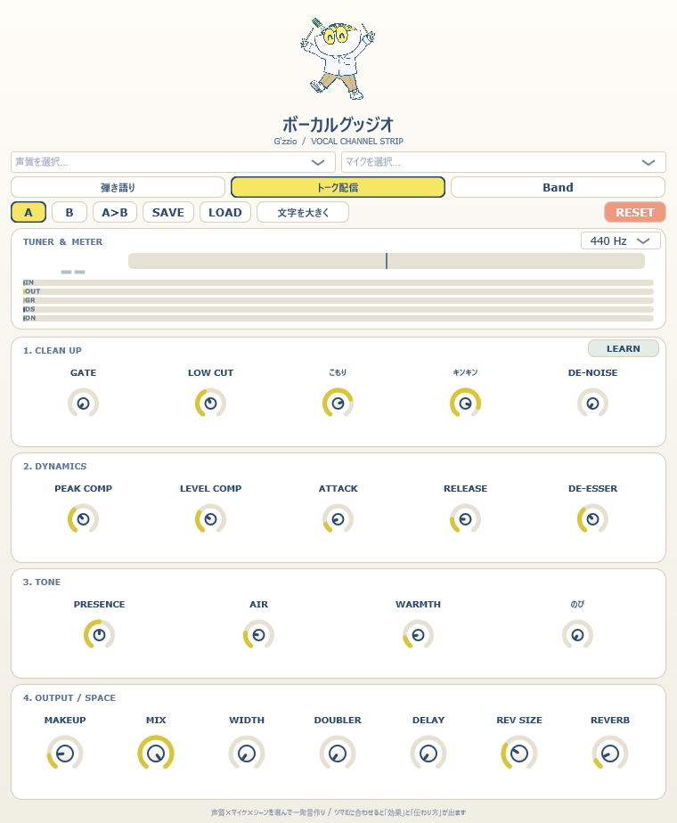

---

### 第2世代：`v1.3.0` 〜 `v1.4.0`（2026年7月10日〜13日公開）— 横ワイド2カラム化・ダークUI＆リアルタイムEQグラフ導入
- **初期ウィンドウ寸法**：`1280 × 790 px`（横ワイド16:10比率、70%〜140%リサイズ対応）
- **同梱バイナリ**：Windows VST3（`VocalGzzio.vst3`）
- **UIの特徴**：
  - 縦長画面ではノートPCで縦が収まりきらない課題と、周波数特性を視覚的に確認したい要望に応え、`1280 × 790 px` の横ワイド2カラム構成（ダークテーマ基調）へ全面刷新。
  - 右カラム上段に大型のリアルタイムFFTスペクトラム＆ダイナミックEQグラフ（スペクトラム・EQカーブ・自動EQ後の3色表示、下部に「量」「選択」の2ノブ）を搭載。
  - ヘッダーに3つ目のドロップダウン「EQプリセット...」と、「文字（フォントサイズ）」「大きさ（ウィンドウ倍率）」の2本のスライダーを追加。
  - `v1.4.0` ではヘッダー右上に「スタンダード / かんたん」切替ボタン、`1. CLEAN UP` カード上部に `AUTO SETUP` ボタンを追加。

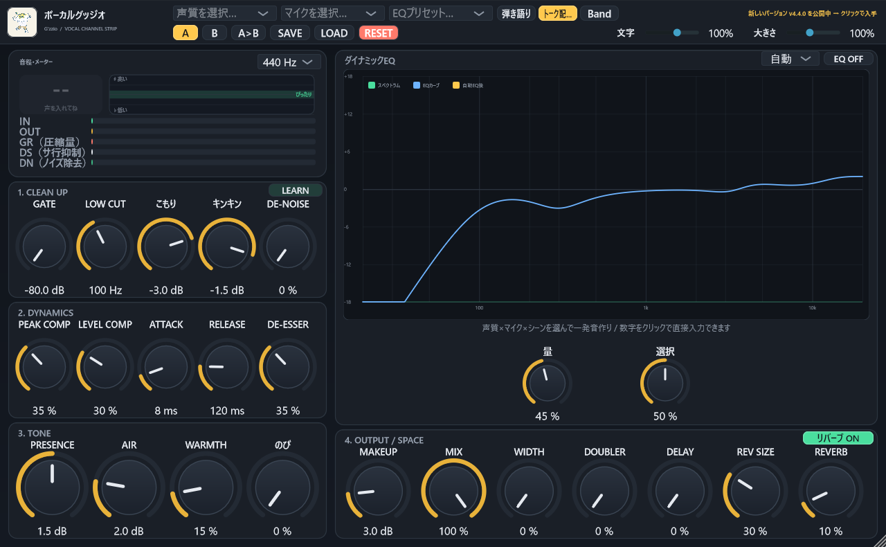

---

### 第3世代：`v1.5.0` 〜 `v1.7.1`（2026年7月15日〜21日公開）— 時計職人ギアノブ・おまかせ設定・十字5モードスイッチ
- **初期ウィンドウ寸法**：`1280 × 834 px`
- **同梱バイナリ**：Windows VST3（`VocalGzzio.vst3`）※`v1.8.4` インストーラーは当時のパッケージング不具合によりバイナリ未同梱（`moduleinfo.json`のみ）であることを展開確認済み。
- **UIの特徴**：
  - ヘッダー直下に横幅いっぱいの「**おまかせ設定**（`トーク自動` / `うた自動`）」ガイドバーを新設し、高さを `790 px` → `834 px` に拡大。
  - セクション名を英語から親しみやすい日本語（`1 きれいにする` / `2 音量をそろえる` / `3 音色をつくる` / `4 ひろがり・仕上げ`）へ刷新し、リバーブの「ひびきの種類」選択コンボボックスを追加。
  - ノブの意匠を、内部で大小の黄金ギアが噛み合う「**時計職人（Watchmaker）ギアノブ**」へ変更。
  - `v1.7.0` でヘッダー右上に5方向セグメント型の「**十字スイッチ**（中央＝標準、左＝ゆるふわ、右＝軽量、上＝ライト、下＝ゆるふわ軽量）」を搭載。ゆるふわモードでは丸文字フォント（Mochiy Pop One）、パステル背景、ぷにぐじマスコット、右下ジュースサーバー演出に切り替わります。

| `v1.7.0` 標準モード（時計職人ダーク配色） | `v1.7.0` ゆるふわモード（パステル＆マスコット演出） |
| :---: | :---: |
| 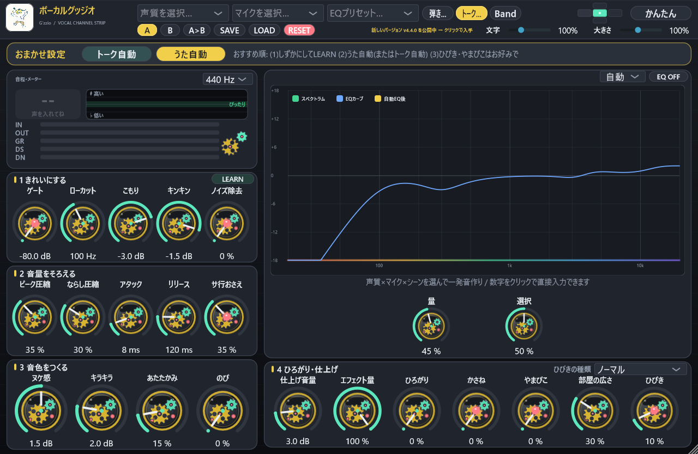 | 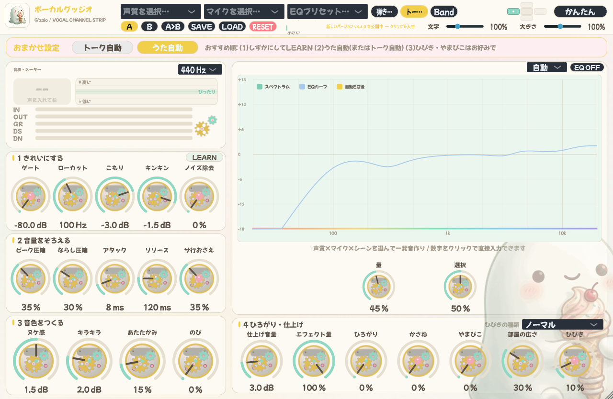 |

---

### 第4世代（前期）：`v1.9.0` 〜 `v2.0.1`（2026年7月23日〜26日公開）— 単体起動アプリ（`.exe`）同梱開始・6テーマチップ・ブランド英語UI
- **初期ウィンドウ寸法**：`1360 × 858 px`
- **同梱バイナリ**：Windows VST3（`VocalGzzio.vst3`）＋ **Windows 単体起動アプリ（`VocalGzzio.exe`）**（`v1.9.0`より同梱開始）
- **UIの特徴**：
  - DAWを起動せずに単体でマイク入力・配信に使えるスタンドアロン版（`VocalGzzio.exe`）が `v1.9.0` からインストーラーに同梱。
  - ヘッダー右上のモード切替が、中央の「`N`（標準）」を6つの楕円ピル（`ゆるふわ` / `自然` / `ブランド` / `オーロラ` / `色覚` / `軽量`）が取り囲む星座型レイアウトに進化。
  - 「**ブランド**」モードを選ぶと、エスプレッソレザー×モノグラム背景とともに全ノブ名・見出し・ガイド文が英語（`1 CLEAN UP`, `2 LEVEL`, `3 TONE`, `4 SPACE & FINISH`）に切り替わる日英二言語システムを搭載。
  - `v2.0.0` で `3 音色をつくる` に5個目のノブ「**艶**」、`4 ひろがり・仕上げ` に8個目のノブ「**サビリフト**」が追加。

| `v1.9.0` 標準モード（1360×858 px） | `v1.9.0` ブランド英語モード（モノグラム＆英語UI） |
| :---: | :---: |
| 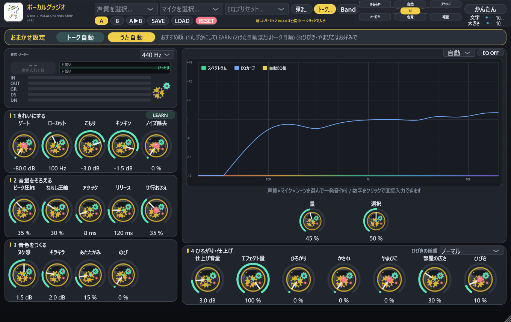 | 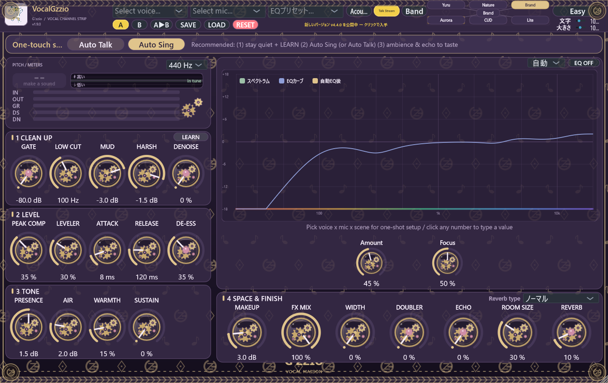 |

---

### 第4世代（後期）：`v2.1.0` 〜 `v2.10.0`（2026年7月26日〜8月6日公開）— 初回「かんたんモード」標準化・右カラム2タブ（EQ／エフェクト）構成
- **初期ウィンドウ寸法**：`1360 × 858 px`
- **同梱バイナリ**：Windows VST3 ＋ 単体起動アプリ（`VocalGzzio.exe`）
- **UIの特徴**：
  - 初めて開いた瞬間の情報量を抑えるため、初期表示を大型ギアノブ7〜8個（`マイク音量` / `ノイズ除去` / `こもり` / `キンキン` / `ならし圧縮` / `サ行おさえ` / `ひびき` / `エフェクト量`）が一列に並ぶ「**かんたんモード**（`こえをととのえる`）」に標準化。
  - ヘッダー中央に「配信音量メーター」を追加し、テーマ切替を横一列の6ピル（`ふつう` / `ゆるふわ` / `自然` / `ブランド` / `色覚` / `軽量`）と大きな緑のスライドスイッチ「`かんたんモード`」に整理。
  - 「かんたんモード」をOFF（こだわりモード）にすると、左側のノブ群に「ポップ」「リップ」「ジー音」「きょり」「音量キープ」「なめらか」「ことば」等が加わり、右カラム上段が「**EQ**」「**エフェクト**（ボイス変換・5人ユニゾン・テンポ同期ディレイ・キャラ声・ピッチ補正・最適キー検出）」の2タブ切替構造に進化。
  - `v2.10.0` でおまかせ設定バー右側に「音の種類（うた）」「点検」「追加遅延バッジ（`+0.0 ms`）」「セッション」ボタンが追加。

| `v2.4.0` かんたんモード（初回既定画面） | `v2.10.0` こだわりモード（全ノブ＋追加遅延バッジ） |
| :---: | :---: |
| 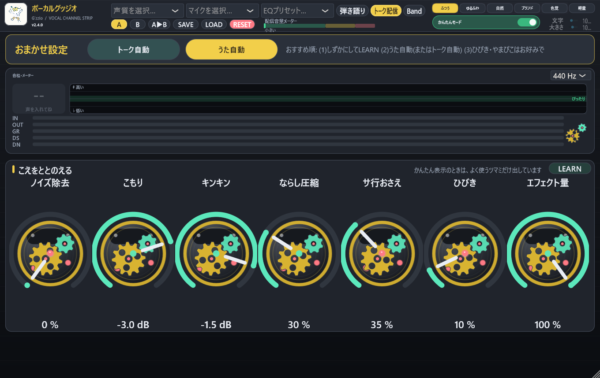 | 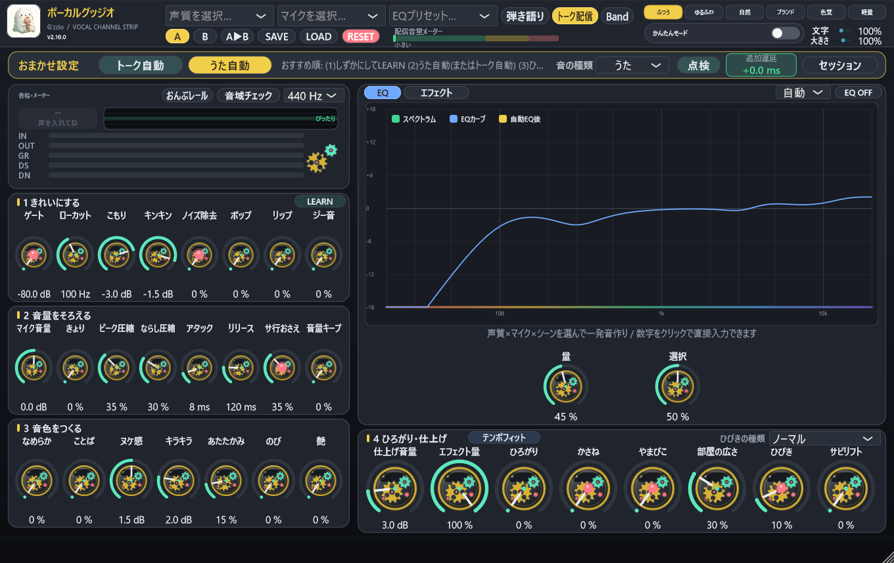 |

---

### 第5世代：`v2.12.0` 〜 `v4.0.0`（2026年8月12日〜8月30日公開）— 左列「音のとおり道」シグナルチェーン＆ゼロ遅延IR「へや」
- **初期ウィンドウ寸法**：`1582 × 892 px`（100%基準）
- **同梱バイナリ**：Windows VST3 ＋ 単体起動アプリ（`VocalGzzio.exe`）
- **UIの特徴**：
  - `v2.12.0` でヘッダーのテーマチップと極小スライダーを廃止し、右上の「**文字・見た目**」ポップアップへ統合。ボタン文字幅の実測レイアウトにより「Band」や「トーク配信」が隠れたり「…」で切れる問題を根絶。ON/OFF状態を示す丸型インジケーターランプを全トグルボタンに導入。
  - こだわりモードの左端に「**音のとおり道（上から下へ）**」カラムを新設。`1 おそうじ` / `2 へんしん` / `3 ととのえ` / `4 音量そろえ` / `5 サ行おさえ` / `6 音色づくり` / `7 キャラ声` / `8 ひろがり` の8モジュールを個別にON/OFFできるほか、上下矢印（▲▼）による処理順の入れ替え、「ぜんぶ入れる / ぜんぶ切る / くらべる」に対応。
  - `v3.1.0` で「音の種類（使いかた）」が4種（`うた` / `アコギだけ` / `しゃべり` / `声とギター`）に拡張され、左列の上下端に固定カード「`入 マイクから`」「`出 しあげ`」を追加。
  - `v4.0.0` で「ひびきの種類」に、部屋の縦横高さと吸音率から鏡像法でインパルス応答（IR）をその場で生成・直接FIR＋先回りFFTで追加遅延0サンプルを実現した畳み込みリバーブ「**へや**」6種（`へや：おふろ` / `へや：カラオケ箱` / `へや：録音スタジオ` / `へや：ライブハウス` / `へや：コンサートホール` / `へや：プレート`）を追加。

| `v2.12.0` こだわりモード（左列「音のとおり道」新設） | `v4.0.0` エフェクトタブ（ボイチェン・5人ユニゾン・ピッチ補正） |
| :---: | :---: |
| 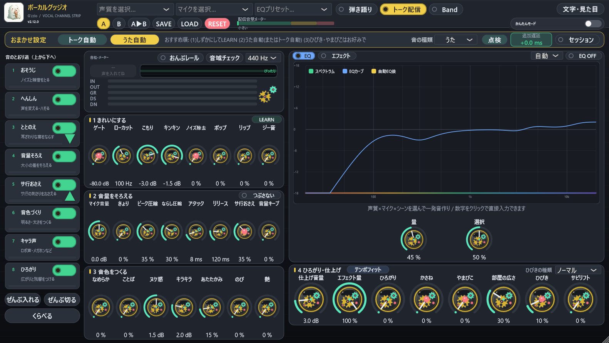 | 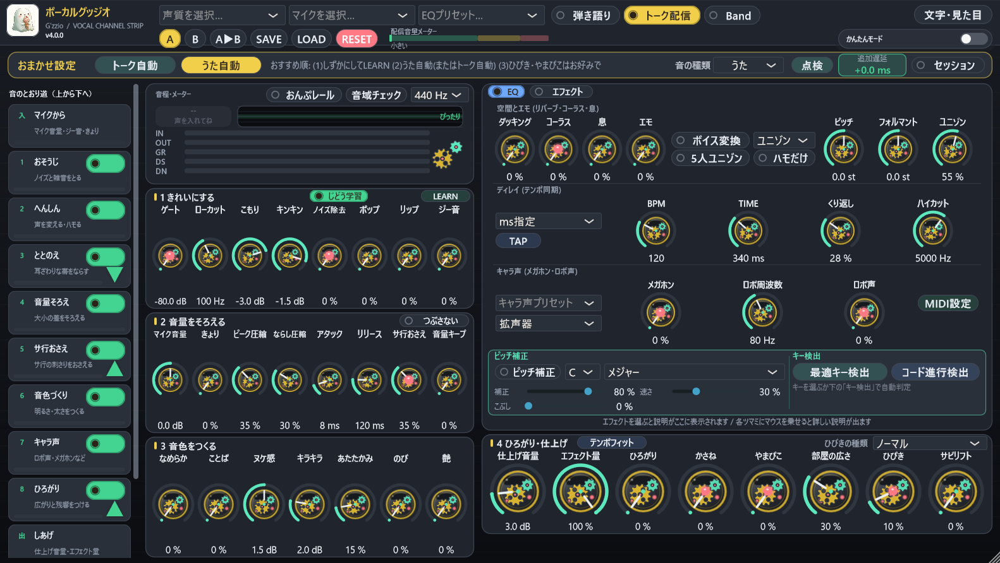 |

| `v4.0.0` ブランド英語モード（Signal path & Full English UI） |
| :---: |
| 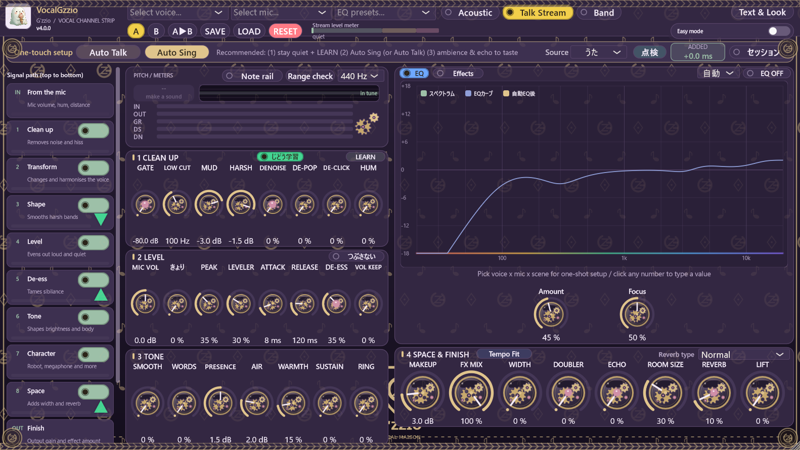 |

---

### 第6世代：`v4.2.0` 〜 `v4.3.3`（2026年9月〜10月公開）— 「総合画面 × 詳細調整」2画面アーキテクチャ・Mac版対応
- **初期ウィンドウ寸法**：`1582 × 892 px`
- **同梱バイナリ**：Windows VST3 ＋ 単体起動 `.exe` ／ **Mac Universal（VST3 / AU `.component` / 単体起動 `.app` / `.pkg`）**（`v4.3.1`〜）
- **UIの特徴**：
  - 従来の「かんたん／こだわり」を刷新し、迷わず3ステップで音作りが完結する「**総合画面**」と、信号経路や全パラメータを追い込める「**詳細調整**」の2画面アーキテクチャへ移行。
  - 左上ロゴをグリーンの波形ピルアイコン＋`VocalGzzio`へモダン化し、時計職人ギアノブから視認性の高いモダン・フラットリングノブ（中央電源ボタン付き）へ刷新。
  - **総合画面の構成**：
    - ヘッダー：`低遅延モード`、`音程・ハモリ`、`チューナー`、`詳細調整`、`文字・見た目`
    - サブバー：`仕上がり（6種）`、`音の種類（うた／アコギ／しゃべり／声とギター）`、`押して原音と比較`、`A / B / A▶B`、`保存 / 読込`
    - 上段3モニター：`歌声・音程`（音程の履歴・音域チェック・5連メーター）、`音の輪郭`（FFTスペクトラム＆EQカーブ）、`入出力`（入力音量・出力音量）
    - 下段3カード：`整える`（ノイズを測る・じどう学習＋4ノブ）、`声をつくる`（4ノブ）、`空間をつくる`（リバーブ入/切＋残響種類＋4ノブ）

| `v4.3.3` 総合画面（標準ダークテーマ） | `v4.3.3` 総合画面（Vライバー・ライトテーマ） |
| :---: | :---: |
| 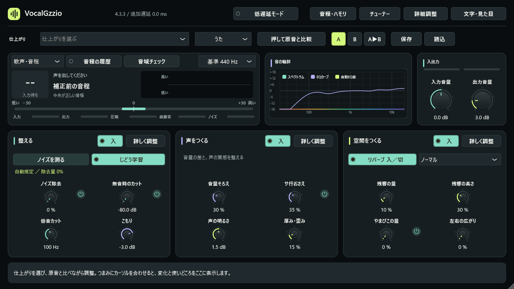 | 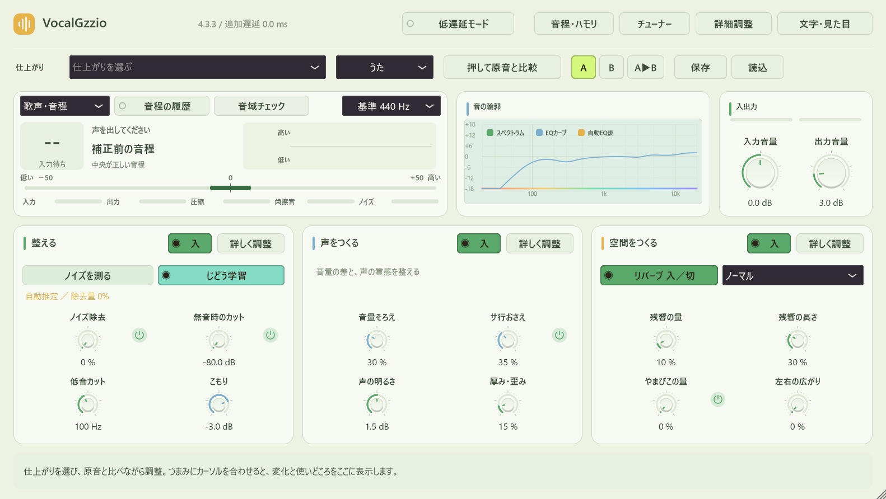 |

| `v4.3.3` 詳細調整画面（左列「音のとおり道」＋全セクション表示） |
| :---: |
| 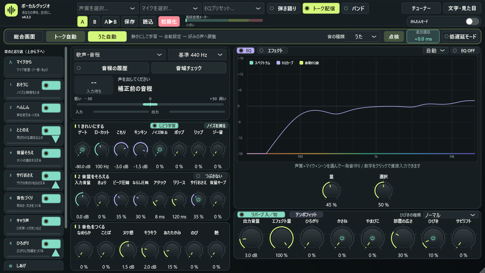 |

---

### 第7世代（最新）：`v4.4.0` Gemini4Argon Edition（2026年10月15日公開）— 4種のワークスペース画面構造 × Argon 2D 声の重力場オーブ × ⚡軽量モード
- **初期ウィンドウ寸法**：`1280 × 720 px` 論理基準（70%〜140%スケーリング・リサイズ対応）
- **同梱バイナリ**：Windows VST3 ＋ 単体起動 `.exe` ／ Mac Universal（VST3 / AU `.component` / 単体起動 `.app` / `.pkg`）
- **UIの特徴**：
  - ヘッダーの `[★ARGON / ♥LIVER / 🎛STUDIO / ◎従来]` ピルにより、単なるカラーテーマ変更ではなく**操作盤の骨格（レイアウト構造）そのものが4通りに変形**するマルチ・ワークスペース構造を新搭載。
  - 画面中央にドラッグ操作で声の距離感と質感を同時成形できる「**Argon 2D 声の重力場オーブ**」と4種の**Voice DNAターゲットボタン**（`★ 歌枠ベルベット` / `♥ ASMRささやき` / `✦ 透明ポップス` / `◆ 3Dバラード`）を搭載。
  - 新開発DSP「**Argon Velvet Engine**（母音追従2次倍音＆135Hz胸鳴り `VELVET` ／ クレスト保護つき14kHz空気感 `SILK AIR` ／ スマホのモノラル再生でも位相キャンセリングゼロの直交拡散 `3D BINAURAL HALO`）」を直感的に制御可能。
  - ヘッダーの `[⚡軽量]` ピル1クリックで、音声DSP品質は100%最高品質のまま4096点FFT・パーティクル演出・半透明ガラス合成を休止しUIタイマーを10Hzへ半減させる「**軽量モード（ECO LITE MODE）**」を搭載。

| `v4.4.0` `[★ ARGON]` 3ウイング・コックピット構造 | `v4.4.0` `[♥ LIVER]` Vライバー12連マカロン五線譜ステージ構造 |
| :---: | :---: |
| 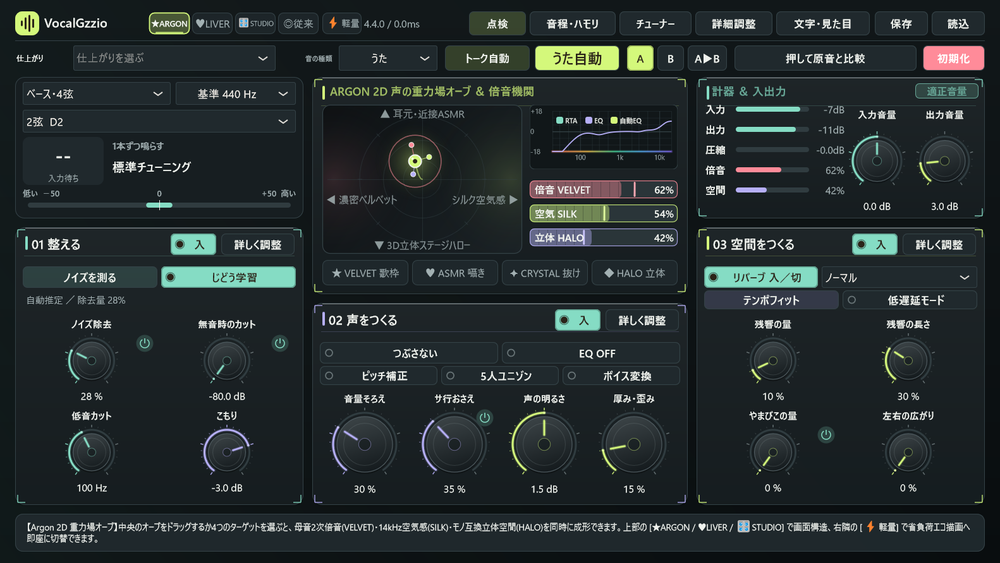 | 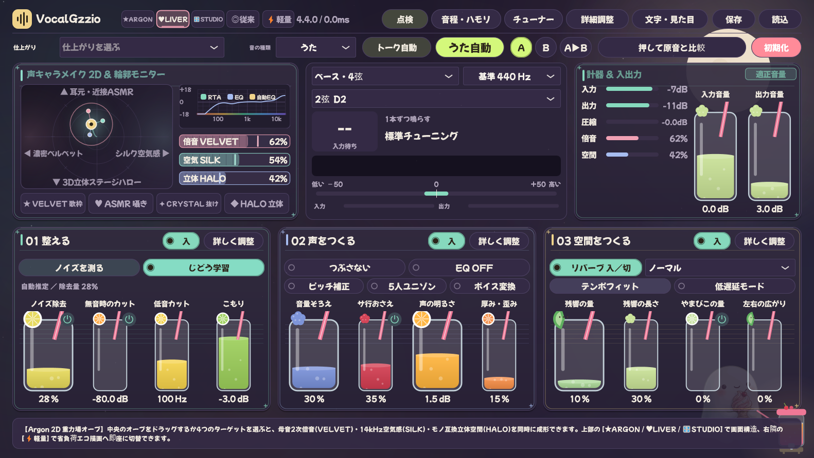 |

| `v4.4.0` `[🎛 STUDIO]` 5列ハードウェア・スタジオラック構造 | `v4.4.0` `[⚡ 軽量]` 省負荷エコモード（FFT休止・10Hz省電力） |
| :---: | :---: |
| 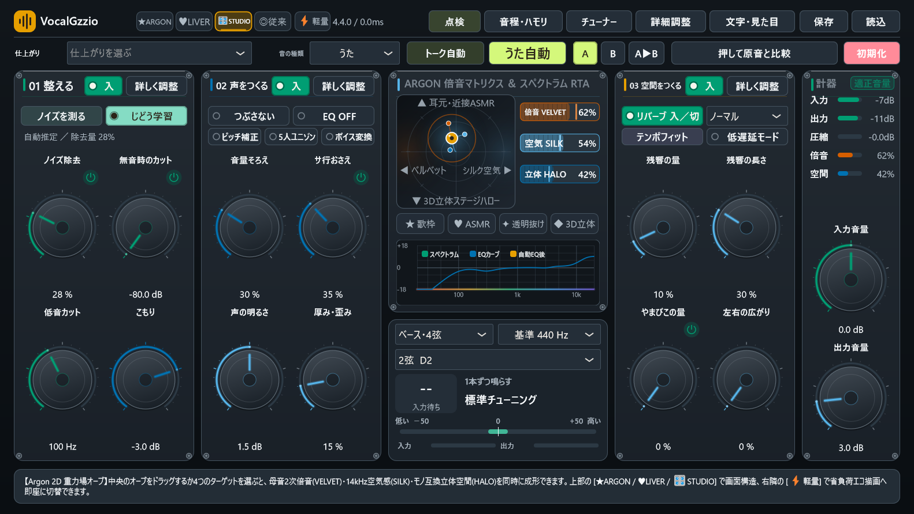 | 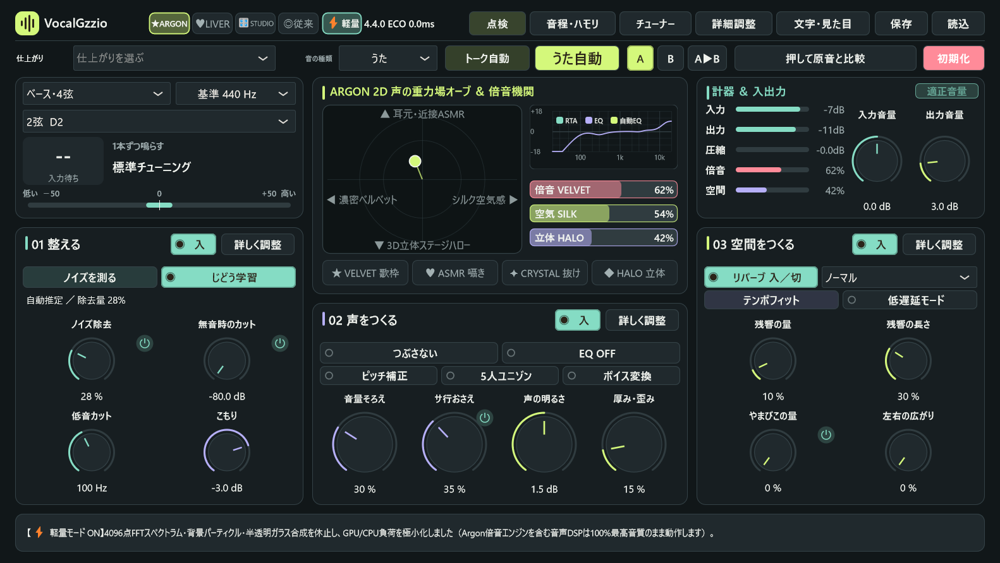 |

---

## 3. 旧版保管パッケージ（全39アーカイブ）実機展開・UI検証一覧

`release/backnumbers/VocalGzzio_旧版保管用_v1.0.0-v4.3.3.zip` に収録されている全37本のWindowsインストーラーおよび2本のMac配布ZIPの展開・UI検証結果一覧です。

| 公開タグ | ファイル名 | 公開日 (UTC) | UI世代 | 初期画面サイズ | VST3容量 | 単体EXE容量 | 実機展開・UI構成の確認備考 |
| :--- | :--- | :--- | :--- | :--- | ---: | ---: | :--- |
| `v4.3.3` | `VocalGzzio_Setup_v4.3.3.exe` | 2026-10-15 | 第6世代 | `1582 × 892` | 8,587 KB | 8,570 KB | 総合画面×詳細調整2画面UI。実機起動・キャプチャ確認済 |
| `v4.3.2` | `VocalGzzio_Setup_v4.3.2.exe` | 2026-10-15 | 第6世代 | `1582 × 892` | 8,442 KB | 8,425 KB | 総合画面×詳細調整2画面UI。展開・バイナリ確認済 |
| `v4.3.2` (Mac) | `VocalGzzio_v4.3.2_Mac_製品版.zip` | 2026-10-15 | 第6世代 | `1582 × 892` | Universal | Universal | macOS Universal (VST3/AU/App/PKG) 収録確認済 |
| `v4.3.1` | `VocalGzzio_Setup_v4.3.1.exe` | 2026-10-15 | 第6世代 | `1582 × 892` | 8,446 KB | 8,428 KB | 総合画面×詳細調整2画面UI。実機起動・キャプチャ確認済 |
| `v4.3.1` (Mac) | `VocalGzzio_v4.3.1_Mac_製品版.zip` | 2026-10-15 | 第6世代 | `1582 × 892` | Universal | Universal | macOS Universal (VST3/AU/App/PKG) 収録確認済 |
| `v4.3.0` | `VocalGzzio_Setup_v4.3.0.exe` | 2026-10-15 | 第6世代 | `1582 × 892` | 8,445 KB | 8,427 KB | 総合画面×詳細調整2画面UI。実機起動・キャプチャ確認済 |
| `v4.2.1` | `VocalGzzio_Setup_v4.2.1.exe` | 2026-10-15 | 第6世代 | `1582 × 892` | 8,420 KB | 8,403 KB | 総合画面×詳細調整2画面UI。展開・バイナリ確認済 |
| `v4.2.0` | `VocalGzzio_Setup_v4.2.0.exe` | 2026-10-15 | 第6世代 | `1582 × 892` | 8,405 KB | 8,387 KB | 第6世代の初版（総合画面3カード化）。実機起動・キャプチャ確認済 |
| `v4.0.0` | `VocalGzzio_Setup_v4.0.0.exe` | 2026-08-30 | 第5世代 | `1582 × 892` | 8,347 KB | 8,330 KB | ゼロ遅延IR「へや」6種追加。実機起動・キャプチャ確認済 |
| `v3.1.0` | `VocalGzzio_Setup_v3.1.0.exe` | 2026-08-20 | 第5世代 | `1582 × 892` | 8,318 KB | 8,301 KB | 使いかた4種・左列「入/出」固定カード。実機起動・キャプチャ確認済 |
| `v3.0.0` | `VocalGzzio_Setup_v3.0.0-dev.exe` | 2026-08-13 | 第5世代 | `1582 × 892` | 8,267 KB | 8,251 KB | 左列「音のとおり道」シグナルチェーン。実機起動・キャプチャ確認済 |
| `v2.12.0` | `VocalGzzio_Setup_v2.12.0.exe` | 2026-08-12 | 第5世代 | `1582 × 892` | 8,262 KB | 8,245 KB | 「文字・見た目」ポップアップ統合・左列追加。実機起動・キャプチャ確認済 |
| `v2.11.0` | `VocalGzzio_Setup_v2.11.0.exe` | 2026-08-06 | 第4世代後期 | `1360 × 858` | 8,177 KB | 8,161 KB | かんたん／こだわり切替＋追加遅延バッジ。展開・バイナリ確認済 |
| `v2.10.0` | `VocalGzzio_Setup_v2.10.0.exe` | 2026-08-06 | 第4世代後期 | `1360 × 858` | 8,176 KB | 8,160 KB | 音の種類・点検・追加遅延バッジ新設。実機起動・キャプチャ確認済 |
| `v2.9.0` | `VocalGzzio_Setup_v2.9.0.exe` | 2026-08-05 | 第4世代後期 | `1360 × 858` | 8,122 KB | 8,103 KB | かんたん／こだわり切替UI。展開・バイナリ確認済 |
| `v.2.8.1` | `VocalGzzio_Setup_v2.8.1.exe` | 2026-08-04 | 第4世代後期 | `1360 × 858` | 8,119 KB | 8,101 KB | かんたん／こだわり切替UI。展開・バイナリ確認済 |
| `v2.8.0` | `VocalGzzio_Setup_v2.8.0.exe` | 2026-07-30 | 第4世代後期 | `1360 × 858` | 8,104 KB | 8,085 KB | うた自動（10秒）表記・マイク音量先頭化。実機起動・キャプチャ確認済 |
| `v2.6.1` | `VocalGzzio_Setup_v2.6.1.exe` | 2026-07-29 | 第4世代後期 | `1360 × 858` | 8,104 KB | 8,085 KB | かんたん／こだわり切替UI。展開・バイナリ確認済 |
| `v2.6.0` | `VocalGzzio_Setup_v2.6.0.exe` | 2026-07-29 | 第4世代後期 | `1360 × 858` | 8,104 KB | 8,085 KB | かんたん／こだわり切替UI。展開・バイナリ確認済 |
| `v2.5.0` | `VocalGzzio_Setup_v2.5.0.exe` | 2026-07-28 | 第4世代後期 | `1360 × 858` | 8,088 KB | 8,070 KB | かんたん／こだわり切替UI。展開・バイナリ確認済 |
| `v.2.4.1` | `VocalGzzio_Setup_v2.4.1.exe` | 2026-07-28 | 第4世代後期 | `1360 × 858` | 8,088 KB | 8,070 KB | かんたん／こだわり切替UI。展開・バイナリ確認済 |
| `v2.4.0` | `VocalGzzio_Setup_v2.4.0.exe` | 2026-07-27 | 第4世代後期 | `1360 × 858` | 8,072 KB | 8,053 KB | 6テーマ横ピル＋かんたんモード緑トグル。実機起動・キャプチャ確認済 |
| `v2.3.0` | `VocalGzzio_Setup_v2.3.0.exe` | 2026-07-26 | 第4世代後期 | `1360 × 858` | 8,069 KB | 8,051 KB | 右カラム2タブ（EQ／エフェクト）構成。展開・バイナリ確認済 |
| `v2.1.0` | `VocalGzzio_Setup_v2.1.0.exe` | 2026-07-26 | 第4世代後期 | `1360 × 858` | 7,776 KB | 8,019 KB | 初回「かんたんモード」標準化。実機起動・キャプチャ確認済 |
| `v2.0.1` | `VocalGzzio_Setup_v2.0.1.exe` | 2026-07-26 | 第4世代前期 | `1360 × 858` | 7,750 KB | 7,999 KB | 星座型6テーマピル＋艶・サビリフト。展開・バイナリ確認済 |
| `v2.0.0` | `VocalGzzio_Setup_v2.0.0.exe` | 2026-07-25 | 第4世代前期 | `1360 × 858` | 7,750 KB | 7,998 KB | 「艶」「サビリフト」ノブ新設。実機起動・キャプチャ確認済 |
| `v1.9.9` | `VocalGzzio_Setup_v1.9.9.exe` | 2026-07-24 | 第4世代前期 | `1360 × 858` | 7,688 KB | 7,937 KB | 星座型6テーマピルUI。実機起動・キャプチャ確認済 |
| `v1.9.7` | `VocalGzzio_Setup_v1.9.7.exe` | 2026-07-24 | 第4世代前期 | `1360 × 858` | 7,685 KB | 7,934 KB | 星座型6テーマピルUI。展開・バイナリ確認済 |
| `v1.9.2` | `VocalGzzio_Setup_v1.9.2.exe` | 2026-07-23 | 第4世代前期 | `1360 × 858` | 7,677 KB | 7,926 KB | 星座型6テーマピルUI。実機起動・キャプチャ確認済 |
| `v1.9.0` | `VocalGzzio_Setup_v1.9.0.exe` | 2026-07-23 | 第4世代前期 | `1360 × 858` | 7,669 KB | 7,917 KB | 単体起動アプリ（`VocalGzzio.exe`）初同梱。実機起動・キャプチャ確認済 |
| `v1.8.4` | `VocalGzzio_Setup_v1.8.4.exe` | 2026-07-22 | （欠番パッケージ） | — | 0 KB | 0 KB | ※当時のビルド梱包不具合により `moduleinfo.json` のみ収録（前後の `v1.7.1` または `v1.9.0` をご利用ください） |
| `v1.7.1` | `VocalGzzio_Setup_v1.7.1.exe` | 2026-07-21 | 第3世代 | `1280 × 834` | 7,568 KB | — | 十字5モードスイッチ＋ゆるふわ。実機起動・キャプチャ確認済 |
| `v1.7.0` | `VocalGzzio_Setup_v1.7.0.exe` | 2026-07-20 | 第3世代 | `1280 × 834` | 7,549 KB | — | 十字5モードスイッチ＋ゆるふわ初搭載。実機起動・キャプチャ確認済 |
| `v1.6.1` | `VocalGzzio_Setup_v1.6.1.exe` | 2026-07-18 | 第3世代 | `1280 × 834` | 7,230 KB | — | 時計職人ギアノブ＋おまかせ設定バー。展開・バイナリ確認済 |
| `v1.6.0` | `VocalGzzio_Setup_v1.6.0.exe` | 2026-07-17 | 第3世代 | `1280 × 834` | 7,222 KB | — | 時計職人ギアノブ＋おまかせ設定バー。実機起動・キャプチャ確認済 |
| `v1.5.0` | `VocalGzzio_Setup_v1.5.0.exe` | 2026-07-15 | 第3世代 | `1280 × 834` | 7,210 KB | — | 第3世代初版（ギアノブ・日本語見出し化）。実機起動・キャプチャ確認済 |
| `v1.4.0` | `VocalGzzio_Setup_v1.4.0.exe` | 2026-07-13 | 第2世代 | `1280 × 790` | 7,199 KB | — | 横ワイド2カラム＋AUTO SETUP。実機起動・キャプチャ確認済 |
| `v1.3.0` | `VocalGzzio_Setup_v1.3.0.exe` | 2026-07-10 | 第2世代 | `1280 × 790` | 7,076 KB | — | 横ワイド2カラム＋FFTスペクトラム初搭載。実機起動・キャプチャ確認済 |
| `v1.0.0` | `VocalGzzio_Setup_v1.0.0.exe` | 2026-07-08 | 第1世代 | `760 × 924` | 6,963 KB | — | 記念すべき初版（縦長クリーム色フラットUI）。実機起動・キャプチャ確認済 |
