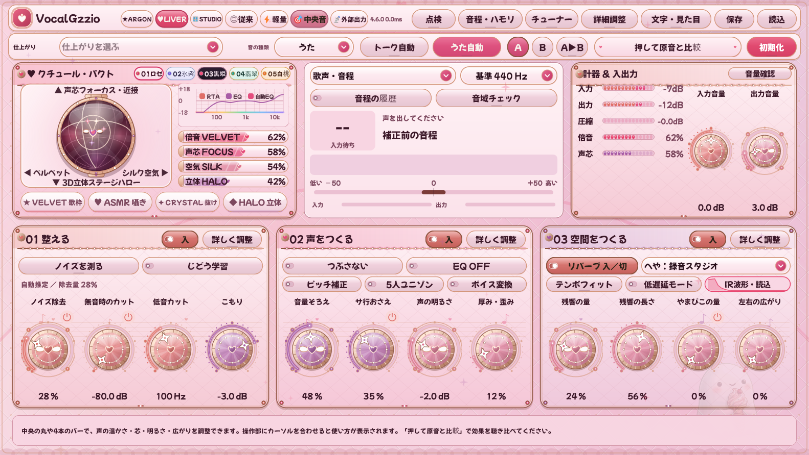

# VocalGzzio 4.6.0 変更記録

更新日：2026年10月17日。5つのクチュール・コスメティック配色、5つのペルソナ別ワークスペース＆テーマ刷新、単体起動版の片耳マイク自動中央化、SYNCROOM / OBS 等への外部仮想オーディオブリッジ出力、空間IRリバーブ「へや」の減衰波形表示＆外部IR読込を追加しました。

## 1. クチュール・コスメティック 5色パレット（♥LIVER ＆ 文字・見た目）

従来の単調なパステル配色を見直し、高級コスメパレットやジュエリーボックスの質感に着想を得た **5種類のクチュール・コスメティック配色** を搭載しました。

| スウォッチ | 配色名 | 特徴 |
|---|---|---|
| **01 ロゼ** | **ロゼ・クチュール（Rose Gold & Ruby）** | ベルベット・プラムブラウンの筐体に、シャンパン・ロゼゴールドの金属リムとルビーフランボワーズの差し色 |
| **02 氷紫** | **アイシーラベンダー（Glacier Lilac & Platinum）** | トワイライト・モーブの筐体に、プラチナシルバーの光沢リムと氷結晶ライラックの透明感 |
| **03 黒姫** | **ノワール・ロリータ（Noir Ruban & Velvet Gothic）** | 漆黒ベルベット・オニキスの筐体に、アンティーク・ローズゴールドの箔押しとフランボワーズピンク |
| **04 翡翠** | **ティファニーミント（Celadon Bijou & Pearl White）** | ミッドナイト・ティールの筐体に、ホワイトゴールドの縁取りとセラドン・ミントの輝き |
| **05 白桃** | **ハニーピーチ（Apricot Miel & Warm Gold）** | エスプレッソ・ローズショコラの筐体に、ハニーゴールドの金属リムと完熟白桃コーラルの温もり |

- 総合画面の `♥LIVER` 選択時に表示される **`01ロゼ` `02氷紫` `03黒姫` `04翡翠` `05白桃`** のスウォッチピルで、1クリックで切り替えられます。
- 上部の `♥LIVER` ボタンを続けてクリックしても、5色を順番に巡回できます。
- 右上の「文字・見た目」ポップアップからも、いつでも5色を直接選択できます。

## 2. 5つのペルソナ別ワークスペースとテーマ刷新

用途や気分に合わせて、画面の配置と世界観を1クリックで切り替えられます（音声処理の設定はどの配置でも共通です）。

- **★ARGON（サイバー・グラスモーフィズム）**：中央の2D声質重力場オーブと4軸バー（倍音・声芯・空気・立体）を大きく見せる近未来ガラス調デザイン。
- **♥LIVER（クチュール・コスメティック）**：歌枠・雑談配信でよく使う操作を横並びにまとめたステージ＆デッキ配置。5色のコスメパレットに対応。
- **☕ゆるふわ（ボタニカル・ラテ＆アナログカフェ）**：目に優しいウォーム・リネンと真鍮・セージグリーンのカフェ調デザイン（昼／夜の切替対応）。
- **🎛STUDIO（ダーク・マホガニー＆ブラス）**：マホガニー木目とヘアライン真鍮・アンバーVU計器を備えたプロスタジオの縦列コンソール配置。
- **◎従来（オーロラ・セレスティアル）**：整える・声をつくる・空間をつくるの3カードを見渡せる標準配置。

## 3. 単体起動版：片耳マイクの自動モノラル中央化（🎯声モノラル中央）

オーディオインターフェースの「入力1（L側）」だけにマイクを接続した際、単体起動アプリ（Standalone）で左耳からしか自分の声が聞こえなくなる問題に対応しました。

- 総合画面の入力欄に **`🎯声モノラル中央`** ボタン（既定でON）を追加しました。
- 片方の入力チャンネルだけに信号が来ている場合でも、自動で中央（両耳）へ揃えて出力します。ステレオ入力をそのまま使いたい場合は1クリックでOFFにできます。

## 4. 単体起動版：SYNCROOM / OBS / VRChat 向け外部配信出力ブリッジ（📡配信出力）

単体起動アプリで整えた声を、そのまま外部の仮想オーディオデバイス（VB-CABLE、Yamaha SYNCROOM / NETDUETTO 等）へ直接送出できる **`📡配信出力`** ブリッジを搭載しました。

- 自分のヘッドホンで遅延の少ないモニター音を聴きながら、SYNCROOM や OBS、VRChat 等へ処理後の声を直接ルーティングできます。

## 5. 空間IRリバーブ「へや」の減衰波形表示 ＆ カスタムIR（.wav / .aiff）読込

- **リアルタイム減衰エンベロープ波形表示**：総合画面の「空間をつくる」カード内に、選択中の「へや」やリバーブの残響減衰カーブと入力連動の響きを視覚表示します。
- **外部IRファイルの読み込み（`📂IR読込`）**：内蔵の6部屋（おふろ・カラオケ箱・録音スタジオ・ライブハウス・コンサートホール・プレート）に加え、お手持ちのインパルス応答ファイル（`.wav` / `.aiff`）を読み込んで畳み込みリバーブとして使用できます。

## 6. 深層ノイズ除去（Deep Denoise）と電源ハム除去の強化

- 扇風機・PCファン・エアコンなどの定常背景ノイズを抑える深層ノイズ除去と、50Hz / 60Hz の電源ハムノイズおよび高調波を抑えるハムキラーの安定性を強化しました。
