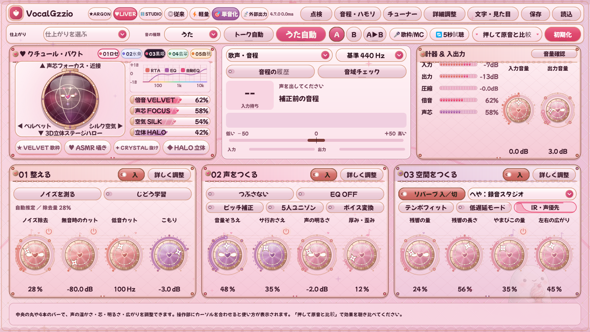

# VocalGzzio 4.7.0 変更記録

更新日：2026年10月18日。歌枠配信・Vライバー・宅録の現場ワークフローを劇的に快適にする **「🎤歌枠 ⇄ 💬雑談MC ワンクリック瞬間切替」「🔄 5秒録音・手放し試聴ルーパー」「🌊 声優先ダッキング（Vocal-Priority Space Ducking）直結＆減衰ゲージ表示」** の3大新機能を追加しました（4.6.0 のクチュール・コスメティック5色パレット、5つのペルソナ画面、片耳マイク中央化、SYNCROOM / OBS 配信出力ブリッジ、空間IR波形＆外部IR読込もすべて搭載しています）。

## 1. 🎤⇄💬 ワンクリック「歌枠 ⇄ 雑談MC」瞬間ライブ切替（非破壊バイパス）

歌枠配信で1曲歌い終わった直後のMCトークやコメント読みの際、リバーブややまびこ（ディレイ）、ハモリが掛かったままだと「お風呂場で喋っている状態」になり、毎回手動で残響を下げると次の曲で元の設定値に戻せなくなる問題を解決しました。

- 総合画面2段目バーに **`[🎤歌枠/MC]`（MC中は `[💬雑談MC中]`）** ピルを新設しました。
- クリック1回で、歌用に追い込んだパラメータ（残響量・やまびこ・左右の広がり・ダブラー・3D Halo・ピッチ補正・5人ユニゾン・ボイス変換）の**数値を1ミリも書き換えずに一時ミュート**し、12msの滑らかなフェードアウトで即座にクリアな雑談MC声へ切り替えます。
- 次の曲に入るときは、もう一度クリックするだけで元の歌枠セッティングへ100%正確に復帰します。

## 2. 🔄 5秒録って手放し聴き比べ「試聴ルーパー（Quick Audition Looper）」

自分で声を出しながらノブや2Dオーブを回すと、自分の頭蓋骨を伝わる「骨伝導音」が混ざるため、実際のリスナーに届いている声色やリバーブの馴染み具合を客観的に判断しづらい問題を解決しました。

- 総合画面2段目バーの `押して原音と比較` のすぐ左に **`[🔄5秒試聴]`** ピルを新設しました。
- 1回押すとマイクの素の声を **5秒間録音（`●録音中...`）** し、直後から **12ms シームレス・クロスフェード付きで自動ループ再生（`🔄試聴再生`）** します。
- 入力トリム直後・原音コピーより手前でループ再生するため、手放しで自分の客観的な声を聴きながら **2Dオーブ・仕上がりプリセット・5色クチュールテーマの切り替え** がリアルタイムに反映されるほか、**`押して原音と比較`** を押せば同じ録音フレーズの「未加工の素の声」と「加工後の声」を骨伝導なしで正確に聴き比べられます。

## 3. 🌊 歌っている最中は歌詞くっきり・語尾で余韻が開く「声優先ダッキング」直結＆可視化

リバーブを深くかけると気持ちいい反面、速いフレーズやサビで歌詞がリバーブに埋もれて聴き取りづらくなる問題を解決しました。

- `03 空間をつくる` のIR波形カプセル（`IR・声優先`）およびIR選択メニューに **「声優先ダッキング（歌っている最中は残響を自動で抑え、語尾でふわっと広げる機能）」** のワンタッチ設定（`切 0%` ／ `標準 45%` ／ `強め 75%`）とリアルタイム減衰ゲージを統合しました。

## 4. クチュール・コスメティック 5色パレット ＆ 5つのペルソナ画面（4.6.0〜）

| スウォッチ | 配色名 | 特徴 |
|---|---|---|
| **01 ロゼ** | **ロゼ・クチュール（Rose Gold & Ruby）** | ベルベット・プラムブラウンの筐体に、シャンパン・ロゼゴールドの金属リムとルビーフランボワーズの差し色 |
| **02 氷紫** | **アイシーラベンダー（Glacier Lilac & Platinum）** | トワイライト・モーブの筐体に、プラチナシルバーの光沢リムと氷結晶ライラックの透明感 |
| **03 黒姫** | **ノワール・ロリータ（Noir Ruban & Velvet Gothic）** | 漆黒ベルベット・オニキスの筐体に、アンティーク・ローズゴールドの箔押しとフランボワーズピンク |
| **04 翡翠** | **ティファニーミント（Celadon Bijou & Pearl White）** | ミッドナイト・ティールの筐体に、ホワイトゴールドの縁取りとセラドン・ミントの輝き |
| **05 白桃** | **ハニーピーチ（Apricot Miel & Warm Gold）** | エスプレッソ・ローズショコラの筐体に、ハニーゴールドの金属リムと完熟白桃コーラルの温もり |

- **`🎯単音化（片耳マイク自動中央化・モノラル最適化）`** ＆ **`📡外部出力（SYNCROOM / VB-CABLE / OBS 同時出力ブリッジ）`**
- **空間IRリバーブ「へや」減衰エンベロープ波形表示 ＆ 外部カスタムIR（`.wav` / `.aiff`）読込**
- **深層ノイズ除去（Deep Denoise）の喋り出し帯域バランス改善**：低〜中低域のインターフェース固有ノイズを深掘り抑制しつつ、喋り出し瞬間の高域ノイズ跳ね（サフサフ感）を防止しました。
